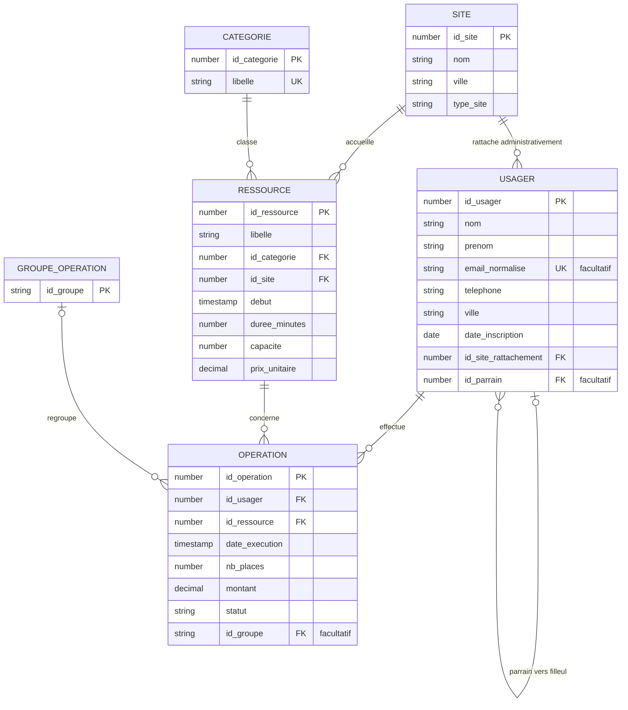
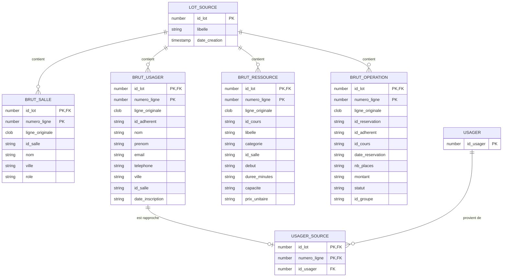

# Schéma entité-association — M1-1

Le modèle s'organise autour des adhérents, des séances de cours et des réservations, nommés USAGER, RESSOURCE et OPERATION. Une réservation relie un adhérent à une séance ; elle peut aussi faire partie d'un groupe. Les [règles de gestion](regles_gestion.md) précisent les choix retenus.

## Modèle métier

Pour lire le diagramme : `||` signifie exactement un, `o|` zéro ou un et `o{` zéro à plusieurs. Un adhérent peut n'avoir encore aucune réservation, et une séance peut n'avoir aucun inscrit. Le siège peut également exister sans accueillir de cours.

OPERATION est l'association porteuse d'attributs entre USAGER et RESSOURCE. Elle contient la date de réservation, les places, le montant et le statut. Nous lui donnons son propre identifiant, car un adhérent peut effectuer plusieurs réservations pour la même séance.

L'association réflexive se lit du parrain vers ses filleuls : un adhérent peut parrainer plusieurs personnes, mais chaque filleul a au maximum un parrain. Le champ facultatif `USAGER.id_parrain` représente ce lien. La condition `id_parrain <> id_usager` empêche un adhérent de se parrainer lui-même. Les données fournies ne renseignent aucun parrainage.

## Lien avec les données brutes

Une personne peut apparaître sur plusieurs lignes du fichier des adhérents. Nous gardons ces lignes séparées dans BRUT_USAGER et les relions à une même personne avec USAGER_SOURCE. Les autres fichiers sont conservés de la même manière dans leurs tables brutes.

Dans chaque table brute, une ligne est identifiée par son lot et son numéro dans le fichier. La référence `BRUT_OPERATION.id_cours` reste libre : elle doit pouvoir contenir l'identifiant d'un cours absent. Dans le modèle métier, en revanche, chaque opération est obligatoirement liée à une ressource existante.

USAGER_SOURCE relie les lignes d'adhérent traitées aux personnes correspondantes. Les lignes ayant le même email normalisé sont rattachées au même usager. Une ligne sans email donne lieu à une personne distincte. Tant qu'une ligne n'est pas traitée, elle peut rester sans correspondance.

Le site d'une réservation se retrouve par le cours. La validité, le caractère multisite d'un groupe et la sur-réservation se calculent à partir des données ; aucun champ supplémentaire ne les stocke.
