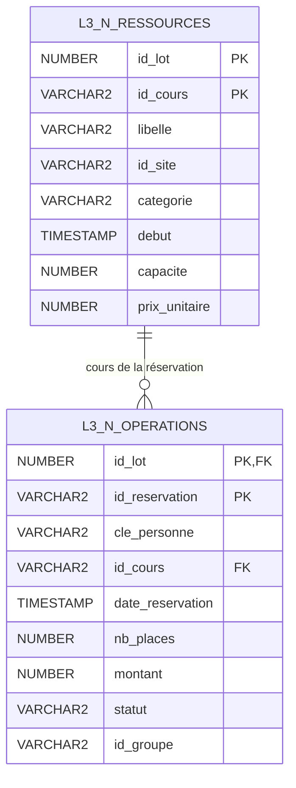
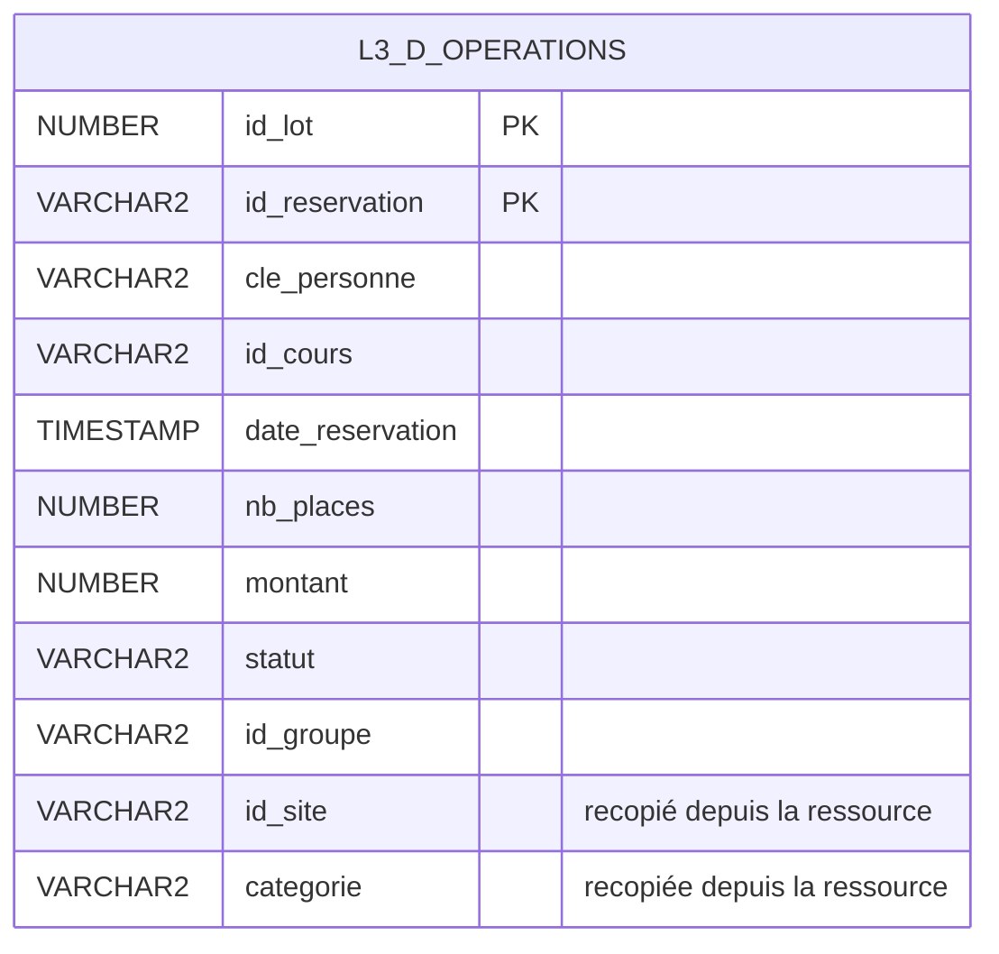
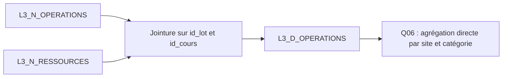

# Schéma après dénormalisation

La dénormalisation ajoute `L3_D_OPERATIONS`, une table de reporting qui contient chaque opération valide avec le site et la catégorie de son cours. Ces deux informations sont ainsi disponibles sans jointure pour Q06. Les tables normalisées sont conservées : la copie s'ajoute au modèle existant.

Ce document décrit les trois tables réellement créées par [denormalisation.sql](../../sql/04_denormalisation/denormalisation.sql). Elles servent à la comparaison L3 ; le modèle métier L1 et les tables brutes restent en place.

## Référence normalisée

La clé primaire des ressources est `(id_lot, id_cours)`. Celle des opérations est `(id_lot, id_reservation)`. La clé étrangère composée `(id_lot, id_cours)` garantit que chaque opération référence un cours du même lot. Un cours peut n'avoir aucune opération valide ou en avoir plusieurs.

## Copie dénormalisée

La clé primaire reste `(id_lot, id_reservation)`. Aucune clé étrangère n'est déclarée sur cette table dans le script actuel : `id_cours` garde la référence logique au cours, mais le contrôle de cohérence repose sur le chargement et la comparaison des copies. Les colonnes `id_lot` des tables L3 n'ont pas de FK déclarée vers LOT_SOURCE. `cle_personne` et `id_groupe` n'ont pas non plus de FK dans ces copies.

| Colonne de L3_D_OPERATIONS | Type Oracle | Origine |
| --- | --- | --- |
| id_lot | NUMBER(12) | L3_N_OPERATIONS |
| id_reservation | VARCHAR2(30 CHAR) | L3_N_OPERATIONS |
| cle_personne | VARCHAR2(350 CHAR) | L3_N_OPERATIONS |
| id_cours | VARCHAR2(30 CHAR) | L3_N_OPERATIONS |
| date_reservation | TIMESTAMP(0) | L3_N_OPERATIONS |
| nb_places | NUMBER(10) | L3_N_OPERATIONS |
| montant | NUMBER(14,2) | L3_N_OPERATIONS |
| statut | VARCHAR2(9 CHAR) | L3_N_OPERATIONS |
| id_groupe | VARCHAR2(100 CHAR) | L3_N_OPERATIONS |
| id_site | VARCHAR2(30 CHAR) | L3_N_RESSOURCES |
| categorie | VARCHAR2(100 CHAR) | L3_N_RESSOURCES |

Toutes les colonnes sont obligatoires sauf `id_groupe`. Les deux composantes de la clé primaire sont obligatoires par la contrainte de clé primaire.

## Construction et usage

Les flèches représentent la construction de la copie, pas des clés étrangères supplémentaires. [copier_donnees_l3.sql](../../sql/04_denormalisation/copier_donnees_l3.sql) réalise cette jointure une fois au chargement. La version normalisée de Q06 doit encore faire cette jointure à chaque exécution ; la version dénormalisée lit directement `id_site`, `categorie` et `statut` dans la copie.

La dépendance `(id_lot, id_cours) → id_site, categorie` se retrouve dans la table des opérations. Comme un cours peut avoir plusieurs réservations, ces valeurs sont répétées : cette table de reporting n'est volontairement plus en 3NF.

Sur le lot 6, chaque version contient 364 516 opérations valides, annulations comprises. Les opérations invalides restent accessibles dans BRUT_OPERATION ; elles n'entrent pas dans la copie utilisée pour Q06. La copie est un instantané sans rafraîchissement automatique : une modification du site ou de la catégorie d'un cours demande une mise à jour contrôlée ou une reconstruction.

Les [résultats de mesure](denormalisation.md) détaillent le gain observé pour Q06 et son coût de stockage. Les noms et coordonnées des usagers ne sont pas recopiés ; `cle_personne`, qui peut contenir un email normalisé, reste une donnée personnelle.
